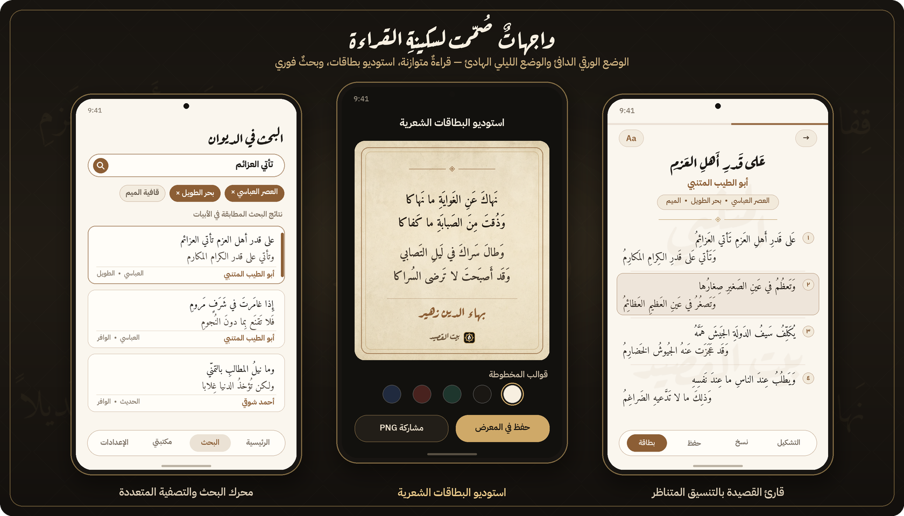

  

 

**تطبيقٌ أدبيٌّ عربيٌّ متكامل يعمل بالكامل دون اتصالٍ بالإنترنت، يجمع عيون الشعر العربي عبر أحد عشر عصراً أدبياً في تجربة قراءةٍ تحريريةٍ هادئة وبحثٍ دقيقٍ فائق السرعة.**

[**🌐 زيارة صفحة التطبيق**](https://hzifa33.com/bayt-al-qaseed/) &nbsp;•&nbsp; [**📥 تحميل التطبيق (APK موقّع)**](https://github.com/Hzifa33/bayt-al-qaseed/releases/tag/v1.0.0) &nbsp;•&nbsp; [**👤 موقع المطوّر**](https://hzifa33.com)

---

## نظرةٌ عامة

وُلد **«بيت القصيد»** ليكون خزانةً شعريةً عربيةً معاصرة تجمع بين رصانة التراث الأدبي ودقّة الهندسة البرمجية الحديثة؛ حيث يضمّ أكثر من **مليونٍ ومائةٍ وستين ألف بيتٍ شعري** مخزّنةً محلياً داخل قاعدة بياناتٍ مُنظّمة ومفهرسة بالكامل، ليتيح للقارئ والباحث تصفّح الدواوين، واستكشاف البحور والقوافي، والوصول الفوري إلى أيّ بيتٍ في أجزاءٍ من الثانية، وتصميم بطاقاتٍ شعريةٍ فنيةٍ عالية الدقّة.

 

 

---

## أرقام الخزانة الشعرية

| المعيار | الإحصائية | الوصف |
| :--- | :---: | :--- |
| **الأبيات الشعرية** | **١٬١٦٢٬١١٩** | أبياتٌ منقّحة ومضبوطة الشطرين (الصدر والعجز) |
| **القصائد الكاملة** | **٩٠٬٢٣٨** | قصائد مصنّفة بالعصر والبحر العروضي وحرف الرويّ |
| **الشعراء والشاعرات** | **٥٤٢** | تراجم وافية ودواوين مرتّبة مع تمييز أيقونات الشاعرات |
| **العصور الأدبية** | **١١ عصراً** | من الجاهلي والمخضرم والإسلامي حتى الحديث والمعاصر |
| **البحور العروضية** | **٢٧ بحراً** | تصفّح فوري ومباشر لقصائد كل بحرٍ عروضي |
| **عيون القصيد الخالدة** | **١٧٢ قصيدة** | مختارات مُعتنى بها (المعلّقات العشر، الرثاء، الغزل، الحكمة، الخالدات) |

---

## أبرز المزايا والقدرات

### 📖 تجربة قراءة تحريرية فاخرة
- **عرضٌ متناظرٌ متقن للأبيات:** يدعم العرض المتدرّج والعرض المتقابل مع موازنةٍ تلقائية لحجم الشطرين وترقيمٍ متوازٍ ومصطفّ للأبيات.
- **بيئة قراءة مريحة للعين:** أربعة أوضاعٍ بصريةٍ مدروسة (**الورقي الدافئ**، **السيبيا**، **الليلي الهادئ**، و**Material You** المتناغم مع ألوان النظام).
- **تحكّمٌ حيّ أثناء القراءة:** تعديل حجم الخط ونوعه والتشكيل والترقيم مباشرةً مع معاينةٍ فورية فوق النص دون مغادرة القصيدة.
- **قراءة بلا انقطاع:** شريط تقدّمٍ رقيق، وتنقّلٌ سلس بين قصائد الشاعر، وإمكانية تحديد بيتٍ واحدٍ أو عدّة أبياتٍ لنسخها أو حفظها أو تحويلها لبطاقةٍ فنية.

### 🔎 محرك بحث دقيق وفائق السرعة
- **بحثٌ بالحروف المتتابعة دون تقييدٍ بالتشكيل:** يفهم التطبيع العربي تلقائياً (توحيد الهمزات والألف المقصورة والتاء المربوطة وتجاهل الحركات)، ويعمل في خيطٍ خلفيٍّ مستقلّ لضمان سلاسة الواجهة.
- **تصفيةٌ متعددة الاختيارات:** إمكانية الجمع بين **أكثر من عصرٍ أدبي** و**أكثر من بحرٍ عروضي** و**أكثر من حرف رويّ** في آنٍ واحد.
- **وصولٌ مباشر إلى البيت المطابق:** عند فتح أيّ نتيجة، تنتقل القصيدة بدقّة إلى منتصف الشاشة عند البيت المطابق مع وميض تمييزٍ لطيف يتلاشى تلقائياً، وتمييز البطاقة المقروءة عند العودة.
- **بحثٌ لحظيٌّ شامل داخل ديوان الشاعر:** يمسح جميع أبيات قصائد الشاعر (وليس المطالع فقط) بشكلٍ فوري وبلا حدود.

### ✨ عيونُ القصيد الخالدة وتصفّح الدواوين
- **نافذةٌ مستقلةٌ لأشهر القصائد:** تضم **١٧٢ قصيدةً خالدة** موزعةً على المعلّقات العشر، والخالدات، والرثاء، والغزل، والحكمة مع بحثٍ وتصفيةٍ داخلية.
- **دواوين منظّمة وتراجم متكاملة:** شريط تمريرٍ سريع بالأقسام (القافية، البحر، الحرف)، وشاشة ترجمةٍ أدبيةٍ وافية لكل شاعر تعرض سيرته وإحصاءات ديوانه وتوزيع بحوره الشعرية.
- **قصيدة عشوائية وبيت اليوم:** استكشافٌ لحظيٌّ للدرر الشعرية بلمسةٍ واحدة.

### 🎨 استوديو البطاقات الشعرية
- **تصميمٌ فنيٌّ فوري عالي الدقّة:** قوالب تراثية وعصرية بملمس ورقة المخطوطة العتيقة ومقاساتٍ جاهزةٍ للنشر (مربّع، منشور، قصة).
- **تخصيصٌ مرن وحفظٌ مباشر:** التحكّم بالتشكيل وتوقيع الشاعر والعصر ونمط الشطرين، مع إمكانية **الحفظ المباشر في معرض الصور** أو المشاركة الفورية بجودة PNG فائقة.

### 🔖 مكتبتي الشخصية والنسخ الاحتياطي
- **تنظيمٌ كامل لمقتنيات القارئ:** أقسامٌ مستقلة للقصائد المفضلة، والأبيات المحفوظة، والشعراء المفضلين، ومجموعات القراءة الخاصة، وسجل القراءة مع تأكيدٍ آمن قبل الحذف.
- **تصدير واستيراد عبر ملفات `JSON`:** حفظ نسخةٍ احتياطيةٍ شاملةٍ لجميع المفضلات والمجموعات وإعدادات التطبيق في ملفٍ واحد واستعادتها في أيّ وقت عبر منتقي ملفات النظام.

---

## التحميل والتثبيت (`v1.0.0`)

جميع النسخ المنشورة في صفحة الإصدارات **موقّعة رقمياً (`v1 / v2 / v3`)** وجاهزة للتثبيت المباشر على أندرويد دون أيّ خطواتٍ إضافية:

| النسخة | المعمارية | التوصية | رابط التحميل المباشر |
| :--- | :---: | :--- | :---: |
| **ARM8 (64-bit)** | `arm64-v8a` | **موصى بها** لمعظم الهواتف الحديثة (حجم أصغر وأداء مثالي) | [**تحميل ARM8 APK**](https://github.com/Hzifa33/bayt-al-qaseed/releases/download/v1.0.0/BaytAlQaseed-v1.0.0-arm64-v8a.apk) |
| **ARM7 (32-bit)** | `armeabi-v7a` | مخصّصة للهواتف الأقدم ذات المعالجات 32-bit | [**تحميل ARM7 APK**](https://github.com/Hzifa33/bayt-al-qaseed/releases/download/v1.0.0/BaytAlQaseed-v1.0.0-armeabi-v7a.apk) |
| **الشاملة (Universal)** | `arm64 + armv7` | متوافقة مع جميع أجهزة أندرويد | [**تحميل Universal APK**](https://github.com/Hzifa33/bayt-al-qaseed/releases/download/v1.0.0/BaytAlQaseed-v1.0.0-universal.apk) |

---

## البنية التقنية والهندسية

- **الإطار واللغة:** `Flutter` و `Dart` ببنية طبقات نظيفة (`Core / Data / Presentation`) وإدارة حالة عبر `Riverpod`.
- **محرك التخزين والبحث:** قاعدة بيانات `SQLite 3` مُحزَّمة محلياً مع فهرسة النص الكامل `FTS5` وفهارس مركّبة وتنفيذ البحث في `Isolate` مستقلّ لمنع أيّ تقطيع في الواجهة.
- **تكامل أندرويد الأصلي:** قنوات `MethodChannel` أصلية بلغة `Kotlin` لحفظ البطاقات في `MediaStore` واستيراد/تصدير ملفات النسخ الاحتياطي عبر `Storage Access Framework`.
- **البناء والتوقيع الآلي:** تكاملٌ مستمر عبر `GitHub Actions` يشمل التحليل الساكن `flutter analyze`، واختبارات الوحدة وقاعدة البيانات `flutter test`، ومحاذاة وتوقيع النسخ الثلاث تلقائياً.

---

## المطوّر

طُوّر تطبيق **«بيت القصيد»** بعنايةٍ وشغفٍ بالأدب العربي والهندسة البرمجية بواسطة **[hzifa33](https://hzifa33.com)**.

- **الموقع الشخصي:** [hzifa33.com](https://hzifa33.com)
- **المستودع البرمجي:** [github.com/Hzifa33/bayt-al-qaseed](https://github.com/Hzifa33/bayt-al-qaseed)
- **صفحة التطبيق:** [hzifa33.com/bayt-al-qaseed](https://hzifa33.com/bayt-al-qaseed/)

