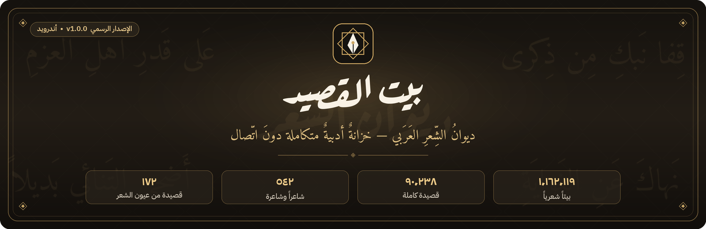

<div dir="rtl" align="center">



<br />

### ✦ أوسع خزانةٍ للشعر العربي بين يديك — دون إنترنت وبلا إعلانات ✦

<p>
  <a href="https://github.com/Hzifa33/bayt-al-qaseed/releases/tag/v1.0.0"></a>
  <a href="https://hzifa33.com/bayt-al-qaseed/"></a>
  <a href="https://github.com/Hzifa33/bayt-al-qaseed/releases/tag/v1.0.0"></a>
  <a href="https://github.com/Hzifa33/bayt-al-qaseed/releases/tag/v1.0.0"></a>
</p>

<p>
  <a href="#-عن-التطبيق">📜 عن التطبيق</a> •
  <a href="#-إحصاءات-الموسوعة">📊 الإحصاءات</a> •
  <a href="#-معاينة-الواجهات">🖼️ الواجهات</a> •
  <a href="#-أبرز-المزايا">✨ المزايا</a> •
  <a href="#-تحميل-التطبيق">📲 التحميل</a> •
  <a href="#-البنية-التقنية">⚙️ التقنية</a> •
  <a href="#-البناء-والتطوير-المحلي">🛠️ التطوير</a>
</p>

</div>

---

<div dir="rtl">

## 📜 عن التطبيق

**«بيت القصيد»** هو الموسوعة الشعرية العربية الشاملة على أندرويد — خزانةٌ أدبيةٌ هادئةٌ تعمل **بالكامل دون اتصال بالإنترنت**، نقيةٌ من الإعلانات والتتبّع والضجيج؛ تجمع أكثر من **٥٫٦٢ مليون بيتٍ شعري** و**٣٣٨٬١٣٤ قصيدة** لـ **١٧٬٢٤٤ شاعراً وشاعرة** عبر **١٣ عصراً أدبياً**، بتجربة قراءةٍ تحريريةٍ فاخرة تمزج دفء الورق العتيق وسكينة الوضع الليلي وجمال الخطوط العربية الأصيلة.

> [!TIP]
> **خصوصيةٌ تامةٌ ١٠٠٪:** يعمل التطبيق بالكامل محلياً على جهازك دون الحاجة لأي اتصال بالشبكة، وبلا حسابات أو إعلانات أو جمعٍ لبيانات المستخدم.

---

## 📊 إحصاءات الموسوعة

<div align="center">


</div>

- 📜 **٥٬٦٢٦٬٣٣٦ بيتاً شعرياً** — مضغوطةٌ بترميز عربي بلا فقدان ومفهرسة بالكامل للبحث الفوري.
- 📚 **٣٣٨٬١٣٤ قصيدةً كاملة** — منقّحة ومصنّفة عروضياً وموضوعياً عبر جميع العصور.
- 🪶 **١٧٬٢٤٤ شاعراً وشاعرة** — مع تراجم وفرز تصاعدي وتنازلي وتصنيف دقيق للشاعرات.
- ⏳ **١٣ عصراً أدبياً** — رحلةٌ متّصلة من العصر الجاهلي حتى الشعر المعاصر.
- 🎵 **٤٧ بحراً عروضياً · ٣٣ رويّاً · ١٠ أغراض شعرية** — تصفّحٌ منظّم مع تصفيةٍ متعددة الأبعاد.
- 🎭 **١٢٧ شعوراً في أطلس المشاعر** — متفرّعة من **٧ مشاعر كبرى** مع انتقالٍ مباشر إلى البيت المعنيّ.
- 👑 **١٧٢ قصيدةً من عيون القصيد الخالدة** — منتقاةٌ من المعلّقات واللاميات والسينيات وروائع التراث.

---

## 🖼️ معاينة الواجهات

<div align="center">


<sub>قارئ القصيدة التحريري • استوديو البطاقات الشعرية • محرك البحث الفوري في ٥٫٦٢ مليون بيت</sub>

</div>

---

## ✨ أبرز المزايا

### 📖 قارئٌ تحريريٌّ فاخر و١٢ خطاً عربياً أصيلاً
- تنسيقٌ متناظرٌ للشطرين (**متدرّج** أو **متقابل**) مع ترقيمٍ مصطفّ وتباعدٍ مريح للعين.
- **١٢ خطاً عربياً مدمجاً** داخل التطبيق (`Amiri`، `Aref Ruqaa`، `Scheherazade New`، `Gulzar`، `Reem Kufi`، `Ruwudu`، `Mirza`، `Harmattan`، `Katibeh`، `Lateef`، `Amiri Quran`، `IBM Plex Sans Arabic`).
- تحكّمٌ حيّ بالتشكيل وحجم الخط، وأربعة أوضاعٍ لونية: **الورقي العتيق**، **الداكن الهادئ**، **الأسود العميق (AMOLED)**، و**Material You**.
- بحثٌ مباشر داخل القصيدة، ونسخٌ فوريٌّ بتفاعلٍ حركيّ أنيق.

### 🔍 محرك بحثٍ فائق السرعة (`FTS5 v8`)
- بحثٌ شاملٌ في **متون ٥٫٦٢ مليون بيت** بالتشكيل أو بدونه خلال أجزاء من الثانية.
- تطبيعٌ عربيٌّ دقيق للهمزات (على الألف والواو والياء) والأحرف غير المرئية، مع ترتيبٍ ذكيّ للنتائج متعددة الكلمات وحفاظٍ تامّ على اتصال الحروف العربية.
- **تصفيةٌ متعددة الأبعاد** (العصر، البحر، حرف الرويّ، والغرض الشعري) مع انتقالٍ دقيق للبيت المطابق في منتصف الشاشة.

### 🎭 أطلسُ المشاعر والأغراض والبحور
- تصفّح **١٢٧ شعوراً** عبر شبكةٍ بصريةٍ أنيقة ومحدّدٍ ثنائيّ المستوى للتفرّعات، مع استخراج **البيت المعنيّ بالضبط** والانتقال المباشر إليه وتمييزه داخل قارئ القصيدة.
- تصفّحٌ منظّم للأغراض الشعرية العشرة، والبحور العروضية، والقوافي مع إظهار **حرف الرويّ** أو أيقونةٍ خطّيةٍ عربية للقصائد متعددة القوافي.
- فلاتر متقدّمة داخل شاشات الأغراض والبحور والمشاعر للوصول الدقيق إلى القصيدة المطلوبة.

### 🎨 استوديو البطاقات الشعرية
- حوّل أيّ بيتٍ أو مجموعة أبيات إلى بطاقةٍ فنيةٍ بملمس المخطوطة العتيقة، مع خياراتٍ متعددة للخطوط والزخارف والألوان.
- حفظٌ مباشرٌ في معرض الصور ومشاركةٌ بدقّة عالية بضغطة زر.

### ⚡ أداءٌ فائق السلاسة (`120fps`) وضغطٌ ذكي (`XZ`)
- تصفّحٌ غير متزامن ومقسّمٌ لصفحات لـ **١٧٬٢٤٤ شاعراً** عبر مسارات خلفية (`Isolate`) دون أيّ تجمّدٍ للواجهة.
- قاعدةُ بياناتٍ مضغوطةٌ بتقنية **`XZ`** تُفكّ محلياً وبشكلٍ متدفّق عند التشغيل الأول فقط مع مؤشّر تقدّمٍ حيّ واستئنافٍ آمن.
- متوافقٌ بالكامل مع **Android 15** ومحاذاة الصفحات **16KB**.

### 🔖 مكتبتك الخاصة والنسخ الاحتياطي
- احفظ قصائدك وأبياتك وشعراءك المفضّلين وأنشئ مجموعاتٍ أدبيةً مخصّصة.
- صدّر كامل مكتبتك وإعدادات التطبيق أو استعدها في أيّ وقت عبر ملف **`JSON`**.

---

## 📲 تحميل التطبيق

جميع الحزم للإصدار الرسمي **`v1.0.0`** **موقّعة رقمياً** وجاهزة للتثبيت المباشر على أندرويد:

### 🌟 نسخة ARM8 (64-bit) — *موصى بها لمعظم الهواتف*
- **المعمارية:** `arm64-v8a` · **الحجم:** `~205 MB`
- **الملاءمة:** الأخفّ حجماً والأسرع أداءً على جميع هواتف أندرويد الحديثة بمعالجات 64-bit.
- [-8C5E35?style=for-the-badge&logo=android&logoColor=white&labelColor=181511)](https://github.com/Hzifa33/bayt-al-qaseed/releases/download/v1.0.0/BaytAlQaseed-v1.0.0-arm64-v8a.apk)

### 📱 نسخة ARM7 (32-bit)
- **المعمارية:** `armeabi-v7a` · **الحجم:** `~203 MB`
- **الملاءمة:** مخصّصة للهواتف والأجهزة الأقدم ذات المعالجات 32-bit.
- [-6E4623?style=for-the-badge&logo=android&logoColor=white&labelColor=181511)](https://github.com/Hzifa33/bayt-al-qaseed/releases/download/v1.0.0/BaytAlQaseed-v1.0.0-armeabi-v7a.apk)

### 📦 النسخة الشاملة (Universal)
- **المعمارية:** `arm64-v8a + armeabi-v7a` · **الحجم:** `~223 MB`
- **الملاءمة:** حزمةٌ واحدةٌ متكاملة تعمل على جميع أجهزة أندرويد إن لم تكن متأكداً من معمارية هاتفك.
- [-C5A567?style=for-the-badge&logo=android&logoColor=181511&labelColor=181511)](https://github.com/Hzifa33/bayt-al-qaseed/releases/download/v1.0.0/BaytAlQaseed-v1.0.0-universal.apk)

> [!NOTE]
> **ملاحظة عند التشغيل الأول:** يفكّ التطبيق ضغط الموسوعة محلياً على جهازك **مرةً واحدة فقط دون الحاجة لأي إنترنت**، مع شريط تقدّمٍ حيّ واستئنافٍ آمن في حال توقّف العملية.

---

## ⚙️ البنية التقنية

<div align="center">


</div>

<details>
<summary><b>📂 استعراض هيكل المشروع والمكوّنات البرمجية</b></summary>

- **`lib/core/`** — نظام التصميم التحريري، السمات والأوضاع اللونية، الحركات الدقيقة (`animations`)، الثوابت، الأدوات المساعدة، والودجات المشتركة.
- **`lib/data/`** — نماذج البيانات (`models`)، مصادر البيانات وقاعدة SQLite3/FTS5 ومحرك فك ضغط `XZ` (`datasources`)، والمستودعات (`repositories`).
- **`lib/presentation/`** — مزوّدات الحالة بـ Riverpod (`providers`)، الشاشات الرئيسية والتحريرية (`screens`)، ومكوّنات الواجهة (`widgets`).
- **`docs/`** — صفحة الهبوط الرسمية للمشروع على [hzifa33.com/bayt-al-qaseed](https://hzifa33.com/bayt-al-qaseed/).

</details>

---

## 🛠️ البناء والتطوير المحلي

<details>
<summary><b>💻 خطوات التشغيل وبناء نسخة الإصدار محلياً</b></summary>

```bash
# 1. تحميل قاعدة البيانات المضغوطة (XZ) من صفحة الإصدارات
gh release download corpus-expanded-v1 -p "bayt_qafiyah_merged.db.xz" -D assets/db/

# 2. تثبيت الحزم وفحص الكود وتشغيل الاختبارات
flutter pub get
flutter analyze
flutter test

# 3. بناء نسخ الإصدار المقسّمة حسب المعمارية
flutter build apk --release --split-per-abi
```

</details>

---

## 🤝 التطوير والتواصل

<div align="center">

طُوّر التطبيق بعنايةٍ وشغفٍ لخدمة اللغة العربية وتراثها الشعري بواسطة **[hzifa33](https://hzifa33.com)**

<p>
  <a href="https://hzifa33.com/bayt-al-qaseed/"></a>
  <a href="https://github.com/Hzifa33/bayt-al-qaseed/releases/tag/v1.0.0"></a>
  <a href="https://hzifa33.com"></a>
</p>

</div>

</div>
